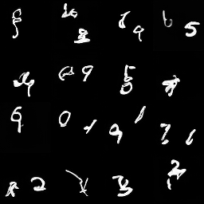

# Latent Video DiT on Moving MNIST

A small factorized space-time Diffusion Transformer (45M parameters) trained with rectified flow on latents from a pretrained Stable Diffusion VAE. Generated clips are evaluated with FVD and temporal-consistency metrics, and every metric is reported next to the same metric on real clips and next to a VAE-only ceiling.

## Results

1000 generated clips per row, 50-step Euler sampling, seed 0. FVD uses VideoMAE features, so it is only comparable between runs of this repo, not to published I3D-based FVD numbers.

| Metric | 9k steps | 20k steps | VAE ceiling* | Real clips |
|---|---|---|---|---|
| FVD (VideoMAE) | 38.56 | 29.50 | 12.45 | 1.30 (noise floor) |
| Flow-warp error | 0.0218 | 0.0197 | 0.0143 | 0.0072 |
| Flicker | 0.0019 | 0.0017 | 0.0015 | 0.0008 |
| Mean frame diff | 0.0522 | 0.0532 | 0.0563 | 0.0546 |
| LPIPS (adjacent) | 0.1144 | 0.1090 | 0.1053 | 0.1027 |

\*VAE ceiling: real clips encoded and decoded by the SD VAE with no DiT involved. It estimates the best the generator could reach in this latent space. Lower is better for every metric except mean frame diff, where the target is to match the real value.

   ### Samples (20k steps)

   

Raw outputs: `results/metrics_9k.json`, `results/metrics_20k.json`, `results/vae_ceiling.json`. `make_table.py` regenerates the table from them.

**Takeaways**

- Extending training from 9k to 20k steps lowered FVD from 38.6 to 29.5 and improved every temporal metric.
- Motion magnitude matches real clips (mean frame diff within about 3%).
- The VAE alone scores FVD 12.5, so the effective floor is about 12.5, not the 1.30 real-vs-real noise floor. Flicker and adjacent-frame LPIPS are already close to what the VAE allows; flow-warp error is roughly 60% VAE-limited.
- The model is still clearly not at real-data quality (FVD 29.5, flow-warp error about 2.7x real), and digits are partly malformed in some samples.

## Pipeline

    64x64 gray clip (16 frames) -> SD VAE (per frame) -> 4x8x8 latents -> VideoDiT -> velocity
    Block = spatial attn (within frame) -> temporal attn (across frames) -> MLP, adaLN-Zero

- Data: generated Moving MNIST (2 digits, speed 2 to 4 px/frame, wall bounce); 20,000 train clips, 2,000 eval clips from the MNIST test split.
- VAE: `stabilityai/sd-vae-ft-mse`, grayscale repeated to 3 channels; reconstruction PSNR 25.24 dB. Latents are cached as float16 and normalized per channel.
- Model: dim 384, depth 12, 6 heads, patch 1 (64 spatial tokens x 16 frames), about 44.9M parameters.
- Objective: rectified flow, x_t = (1 - t) x0 + t eps, velocity target eps - x0, logit-normal t sampling.
- Training: AdamW, lr 2e-4, 1000-step warmup, grad clip 1.0, EMA weights, batch size 16, no mixed precision (`--amp none`), 20,000 steps on a single GPU (first 9k steps on a Colab T4).
- Sampling: Euler (50 steps) from the EMA weights; Heun is also implemented but not evaluated here.

## Run order

    pip install -r requirements.txt
    python model.py                      # self-test: shapes, gradients
    python data.py                       # data/train.npy, data/eval.npy
    python cache_latents.py              # data/train_latents.npy + latent_stats.pt, prints VAE PSNR
    python train.py --out runs/base --steps 20000 --bs 16 --amp none --save_every 1000 --sample_every 100000
    python sample.py --ckpt runs/base/ema_0020000.pt --n 1000 --steps 50 --out samples/gen_20k_1000.npy
    python eval.py --gen samples/gen_20k_1000.npy --real data/eval.npy --n 1000 --bs 8 --out results/metrics_20k.json

Training resumes automatically from `runs/base/last.pt`. If bf16 is supported on your GPU you can drop `--amp none`.

VAE ceiling (needs `vae_ceiling.py`, which re-decodes cached latents of real clips):

    python vae_ceiling.py
    python eval.py --gen samples/vae_recon_1000.npy --real data/eval.npy --n 1000 --bs 8 --out results/vae_ceiling.json

Results table:

    python make_table.py

## Evaluation notes

- **FVD** uses VideoMAE (`MCG-NJU/videomae-base-finetuned-kinetics`) features. `--extractor i3d --i3d_path` exists but is untested here.
- **Noise floor**: FVD between two disjoint sets of real eval clips (1.30 here). Report model FVD next to it, and next to the VAE ceiling.
- **Temporal metrics**: Farneback flow-warp error, flicker (change in global mean intensity), mean absolute frame difference, and LPIPS (AlexNet) between adjacent frames. The goal is to match the real values, not to minimize them.
- Use at least 1,000 clips; FVD is noisy below that. All results are from a single sampling seed, so only large differences should be trusted.
- If `transformers` prints a VideoMAE load report listing `MISSING` or `UNEXPECTED` keys, FVD features are unreliable; `pip install "transformers>=4.40,<5"` fixed this during development.

## Limitations

- Single seed, no confidence intervals.
- Sampler and step-count sweeps, loss-schedule comparisons and a spatial-only baseline have not been run.
- The 8x8 latent grid caps temporal smoothness (see VAE ceiling); lower-compression latents would be needed to go below it.

## Files

`data.py` generator | `cache_latents.py` VAE encode | `model.py` DiT | `diffusion.py` loss + samplers |
`train.py` | `sample.py` | `metrics.py` numpy/OpenCV metrics | `eval.py` FVD + reports |
`vae_ceiling.py` VAE-only reference | `make_table.py` results table | `utils.py`